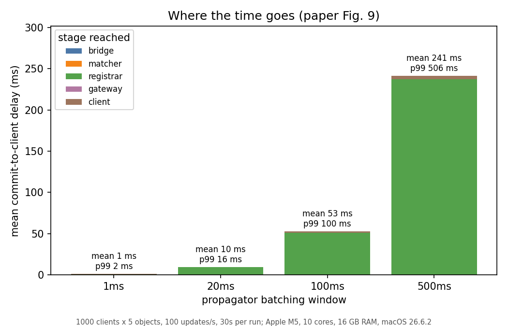
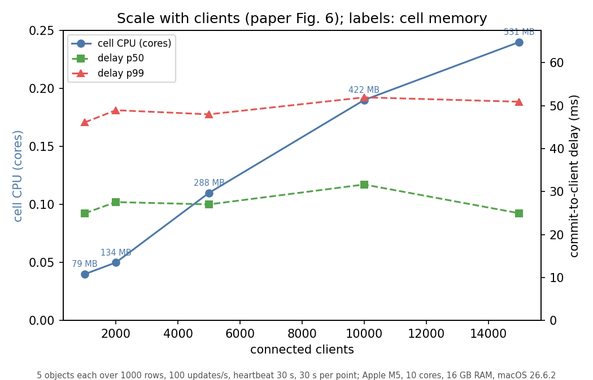
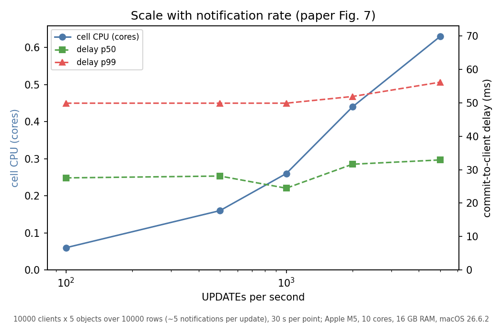
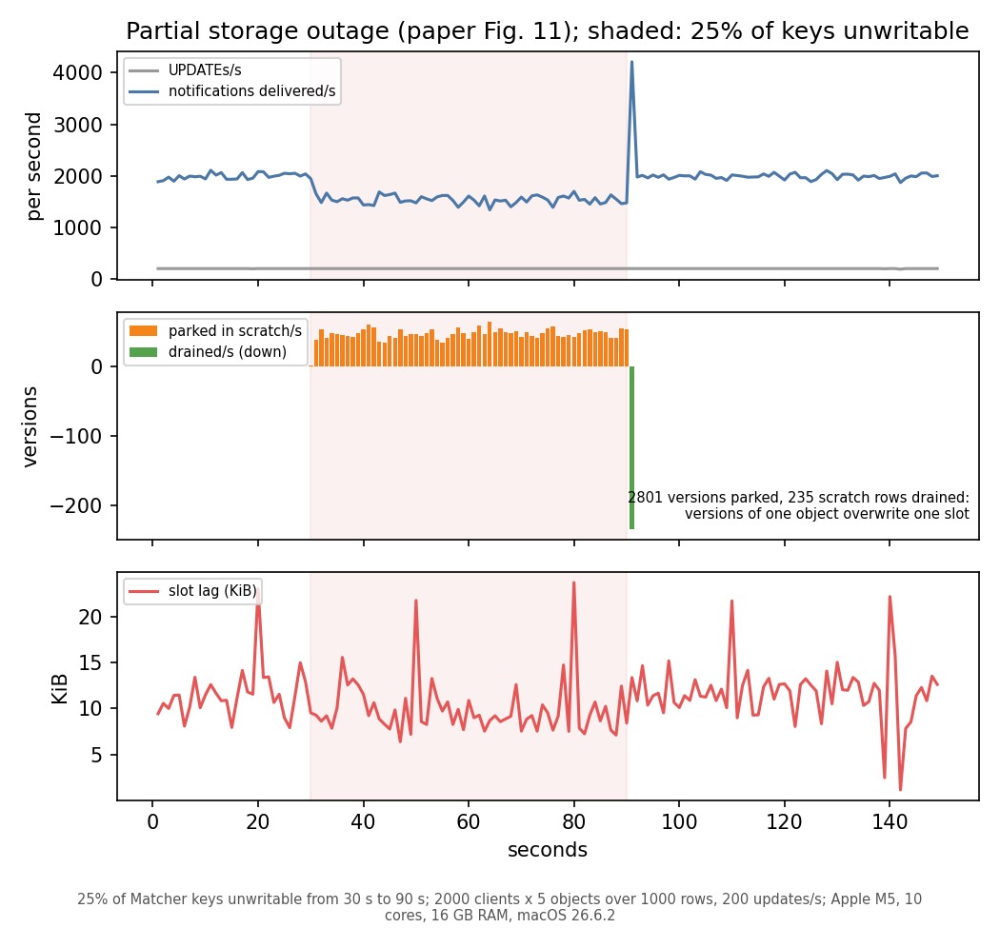

# Herald

Herald is a self-healing cache-invalidation service for Postgres-backed applications.
When a row changes, every browser tab and backend service that cached it hears about it
within a second. The application needs no `publish()` calls, because Herald reads changes
straight from Postgres's write-ahead log. You can also delete all of Herald's own state
while it's running without losing an update. It is a re-implementation of Google's
[Thialfi](https://research.google/pubs/thialfi-a-client-notification-service-for-internet-scale-applications/)
(Adya, Cooper, Myers, Piatek, SOSP 2011).

**Status:** under construction.

## Quick start

```sh
make dev                  # one-process cell + Bridge + demo store on :8080
open http://localhost:8080
psql -d postgres -c "UPDATE products SET price = 12 WHERE id = 1"   # the page updates live
```

`make dev` creates a demo `products` table, a publication and a replication slot
(`herald_dev`) in the database named by `PG`. The slot keeps WAL while herald-dev is
stopped; drop it when you're done: `SELECT pg_drop_replication_slot('herald_dev');`.

### As separate processes

```sh
bench/cluster.sh   # bridge, 2 matchers, 2 registrars, gateway as local processes;
                   # kills and restarts each kind, checking a SQL UPDATE still arrives
docker compose -f deploy/docker-compose.yml up --build -d # the same cell in containers:
                   # demo on :8080, its Postgres on host port 5433
bench/compose-check.sh   # crashes each container in turn, checking an UPDATE still arrives
```

Processes talk over gRPC ([proto/herald.proto](proto/herald.proto)) and find each other
through a static partition map ([deploy/partitions.yaml](deploy/partitions.yaml)).

## Correctness

**Property** (paper §5): if a well-behaved client registers for an object, it always
eventually learns that object's latest version. Duplicates, reordering and skipped
intermediate versions are allowed.

**Chaos simulation** ([internal/sim](internal/sim/sim_test.go)): one cell with 3 Registrars,
3 Matchers and 30 clients watching 20 objects, for 400 rounds. It drops 20% of client
requests, client replies and fast-path pushes, and fails 10% of internal RPCs. Clients
restart at random, individual Matchers and Registrars crash, idle clients are
garbage-collected and come back as zombies, and **all server state is wiped twice**. Every
seed runs twice: memory-only (crashed servers come back empty), and with persistent state
(crashed servers reload it, while 5% of store writes fail and a quarter of the Matcher key
space goes unwritable twice for 60–70 rounds). The Bridge stand-in consumes its log strictly
in order, like the real one, and must not fall behind during those outages. A few seeds
also run on real Postgres. After the network heals, every client must hold the latest version of everything
it wants. The default 200 seeds run in about a second with 0 violations, and a given seed
always gives the same result.

**Mutation testing** ([bench/mutate.sh](bench/mutate.sh)) shows the test can fail: each
row turns off one mechanism.

| Mechanism removed | Violations (200 seeds × 2 modes) | What it shows |
|---|---:|---|
| none | 0 | baseline |
| Registrar post-propagation | 10,751 | clients that register after the last change never learn it |
| Registration sync (full resend on new token / digest mismatch) | 58,704 | after a wipe, servers never relearn registrations |
| Retransmission of unacked notifications | 2,084 | the fast path alone loses updates |
| Matcher keeps failed deliveries pending | 4,038 | internal RPC failures silently drop updates |
| Registrars re-send registrations to a restarted Matcher | 2,422 | a memory-only Matcher that crashes forgets who is registered |
| Write to the store before applying in memory | 7 | a failed write that still updates memory is lost on the next restart |
| Reloaded Registrar replays unpropagated registrations | 41 | registrations in flight at a crash never reach their Matcher |
| Client acks only registered objects | 29 | a real bug the simulation found: a restarted client acked pushes before restoring its registrations |
| Park unwritable versions in scratch | 400 | every one of the 400 outages stalls the Bridge (backlog 12–47 versions, vs. at most 1 with scratch) |
| Drain scratch back into the Matcher table | 1,030 | versions acked to the Bridge during an outage are lost |

## Persistent soft state

With `-store`, Matchers and Registrars keep their state in Postgres (schema `herald_<cell>`,
tables mirroring paper Table 2; see [internal/store/schema.sql](internal/store/schema.sql)).
Every change is written before it is applied or acknowledged, as one idempotent upsert. A
restarted server reloads its own key range with one range scan: in
`TestRegistrarRestartCausesNoResyncs`, a Registrar holding 10,000 clients restarts in
about 11 ms and none of its clients has to re-sync. Clients idle longer than `-gc-ttl` are
garbage-collected; if one returns, it gets a fresh ID and re-registers (paper §4.2.4).
`herald wipe` truncates the cell's state and moves its epoch forward. Correctness never
depends on the store: wiping it only costs a round of re-syncs.

## Partial storage outages

Real storage rarely fails all at once; a few key ranges go away for a while (paper §4.2.6).
The Bridge reads one ordered log, so a single unwritable Matcher row would stall the
replication slot and every notification behind it. Instead, the Matcher parks that version
in a `scratch` table and accepts the publish. The slot is chosen by a salted hash of the
object ID, with the retry count as the salt. Successive versions of a hot object overwrite
one slot, and a slot on a bad tablet makes the next salt land elsewhere. A drain pass moves
parked versions into place once their rows are writable again.

`TestBrownout` runs this against real Postgres. A quarter of the Matcher key space is made
unwritable (`server.FaultyStore`) and every row is updated. The replication slot still catches
up to zero lag, the other 75% of objects notify immediately, and the parked versions arrive
once the outage ends. To try it by hand, run `herald-dev -store -pg ...` and then
`POST /admin/outage?fraction=0.25`, and watch `herald_scratch_buffered_total` on `/metrics`
(Herald's version of the paper's Fig. 11).

Building this exposed a partitioning bug: FNV-1a's top bits barely change when keys differ
only at the end, so `obj:0`..`obj:19` all landed on one of three servers. The partition hash
now ends with MurmurHash3's finalizer. A store written under the old layout is wiped on open,
because its keys sit in the wrong servers' ranges, and soft state makes that safe.

## Observability

Every process serves Prometheus metrics with `-metrics :9102`. `herald-dev` serves them on
its own port at `/metrics`. The docker-compose cell also runs Prometheus and Grafana, with a
provisioned dashboard ([deploy/grafana/dashboards/herald.json](deploy/grafana/dashboards/herald.json)):

```sh
docker compose -f deploy/docker-compose.yml up --build -d
open http://localhost:3000      # Grafana, Herald dashboard, no login
```

| Metric | Type | What it tells you |
|---|---|---|
| `herald_bridge_slot_lag_bytes` | gauge | WAL Postgres retains for the slot; the early warning for everything |
| `herald_publish_total`, `herald_publish_retries_total` | counter | Bridge throughput and health |
| `herald_registrar_pending_notifications` | gauge | unacked backlog per Registrar |
| `herald_resyncs_total{reason}` | counter | `new_token` (wipe/restart), `digest_mismatch`, `zombie` (GC) |
| `herald_unknown_notifications_total` | counter | refetches caused by lost state; spikes after wipes |
| `herald_clients_online` | gauge | open WebSockets per gateway |
| `herald_scratch_buffered_total`, `herald_scratch_drained_total` | counter | partial storage outages (paper Fig. 11) |

## Benchmarks

Every notification carries a timestamp from each stage it crosses: the commit, the Bridge, the
Matcher, the Registrar and the gateway (paper §6.3). The client turns those into per-stage
delays. [bin/herald-load](cmd/herald-load/main.go) opens thousands of simulated clients over
real WebSockets and drives UPDATEs into Postgres. It reports p50, p99 and mean delays per stage
and exports them as `herald_delivery_seconds{stage}`.
Each chart has one script that regenerates it from scratch, and the raw CSVs are in
[bench/results](bench/results).

### Latency budget (paper Fig. 9)



`bench/latency.sh` · Apple M5 (10 cores, 16 GB), single `herald-dev` process (one clock, so
stage deltas are exact), local Postgres 16, 1,000 clients × 5 objects, 100 UPDATEs/s, 30 s per
run after 10 s of warm-up.

As in the paper, the batching window dominates. The `registrar` stage is the time from a
Matcher accepting a version until its propagator delivers it, which averages half the window.
Everything else is a fraction of a millisecond: commit to Bridge about 0.2 ms, Matcher about
10 µs, and gateway to client about 0.3 ms. With a 1 ms window, the median from commit to client
is **1.1 ms** and the p99 is **1.9 ms**. The paper's production system ran a 200–500 ms window
on purpose, to batch work, and that is the trade-off this chart prices. At 500 ms, the client
also receives about 13% fewer notifications. That's reliable *signaling* at work: several
updates to one object inside a window collapse into one notification for the latest version.

### Scale with clients (paper Fig. 6)



`bench/scale-clients.sh` · same machine, single `herald-dev` process, 1k → 15k clients over
real WebSockets, 5 objects each over 1,000 rows, 30 s heartbeat, 100 UPDATEs/s.

CPU and memory grow linearly with clients: 0.24 cores and 531 MB at 15k, about 35 KB per
client. The delay stays flat (p50 25–32 ms, p99 46–52 ms), set by the 50 ms batching
window. The ramp stops at 15k because one macOS process can open only about 16k sockets to
one address (the ephemeral port range), not because Herald runs out of headroom. The paper
went much higher by spreading load over many machines.

### Scale with notification rate (paper Fig. 7)



`bench/scale-rate.sh` · 10,000 clients × 5 objects over 10,000 rows (about 5 notifications per
UPDATE), 100 → 5,000 UPDATEs/s. That is up to about 25,000 notifications/s.

CPU grows with the rate, and at 5,000 UPDATEs/s the whole cell (Bridge, Matchers, Registrars,
gateway) uses 0.63 cores. The delay barely moves: p99 goes from 50 ms to 56 ms. Postgres,
the load generator and Herald all share the same laptop, so treat the absolute numbers as an
upper bound on Herald's cost, not a measurement of it.

### Storage brown-out (paper Fig. 11)



`bench/brownout.sh` · `herald-dev -store`, 2,000 clients, 200 UPDATEs/s, with 25% of the
Matcher key space unwritable from 30 s to 90 s (`server.FaultyStore`).

Deliveries drop to about 77% of normal, the slot lag stays flat (a few KiB), and the Bridge
never stalls. About 2,800 versions were parked, and they collapsed into 235 scratch rows,
because successive versions of one object share a slot. All of them drained within a second
of the outage ending, and clients caught up in one burst.

This experiment found a bug that the unit tests and the simulation had missed. With 1,024
scratch slots and 8 salts, one object eventually found all its slots either unwritable or
taken by other parked objects. Its publish failed and the Bridge stalled for the rest of the
outage. Scratch now has 65,536 slots and 16 salts, and `TestScratchSurvivesCrowding` parks
2,000 objects to keep it that way.

## Develop

```sh
make test      # unit tests, no database needed
make test-pg   # also runs Postgres tests (needs wal_level=logical; see deploy/docker-compose.yml)
bench/mutate.sh  # mutation table above
```

## Postgres setup

```sql
-- once per database: which tables Herald watches
CREATE PUBLICATION herald_pub FOR TABLE products, orders;   -- or FOR ALL TABLES
-- once per Herald cell: its durable cursor into the WAL
SELECT pg_create_logical_replication_slot('herald_cell_a', 'pgoutput');
-- watch how much WAL a stalled Bridge is forcing Postgres to keep
SELECT slot_name, pg_size_pretty(pg_wal_lsn_diff(pg_current_wal_lsn(), confirmed_flush_lsn)) AS lag
FROM pg_replication_slots;
```

Tables need a primary key so updates and deletes carry it. Each row change becomes
`table:pk` and `table:*` notifications versioned by the transaction's commit LSN.
